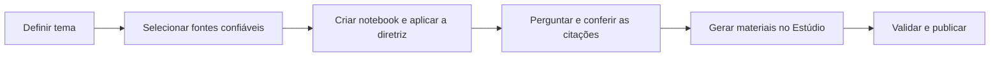

# 🧠 AXIOS - Segundo cérebro com IA

> Um notebook especialista em um único tema, alimentado apenas por fontes confiáveis e sempre com citação.


O AXIOS é um segundo cérebro com IA: um notebook especialista em um único tema, alimentado apenas por fontes confiáveis em mais de um formato (vídeos do YouTube, artigos e PDFs). O notebook responde com citações das fontes e gera materiais de estudo, como mapa mental, slides, guia de estudos e resumo em áudio. Este repositório documenta o trabalho completo: critérios de confiança, registro de fontes, diretriz de comportamento, perguntas e respostas, materiais gerados e um script de validação.

## 📑 Índice

- [Visão geral do fluxo](#visão-geral-do-fluxo)
- [1. Tema e objetivo](#1-tema-e-objetivo)
- [2. Fontes e por que são confiáveis](#2-fontes-e-por-que-são-confiáveis)
- [3. Diretriz de comportamento](#3-diretriz-de-comportamento)
- [4. Perguntas, respostas e fontes](#4-perguntas-respostas-e-fontes)
- [5. Link do notebook](#5-link-do-notebook)
- [Materiais gerados](#materiais-gerados)
- [Estrutura de pastas](#estrutura-de-pastas)
- [O que é automatizado e o que é manual](#o-que-é-automatizado-e-o-que-é-manual)
- [Como validar](#como-validar)

## 🗺️ Visão geral do fluxo



| Etapa | Documento de apoio |
| --- | --- |
| Selecionar fontes | [Critérios de confiança](docs/criterios-de-confianca.md) e [Registro de fontes](docs/registro-de-fontes.md) |
| Aplicar a diretriz | [Diretriz de comportamento (arquivo)](docs/diretriz-de-comportamento.md) |
| Conversar com as fontes | [Registro de perguntas](docs/registro-de-perguntas.md) |
| Passo a passo manual | [Roteiro manual](docs/roteiro-manual.md) |
| Revisar a qualidade | [Checklist de qualidade](docs/checklist-qualidade.md) |

## 1. Tema e objetivo

Tema: arquitetura de um copiloto de ensino de lógica de programação que combina camada scriptada e Small Language Model (SLM) atuando como tutor socrático, com o objetivo de entender como essa combinação funciona (proposto).

## 2. Fontes e por que são confiáveis

Os critérios usados para aprovar uma fonte estão em [Critérios de confiança](docs/criterios-de-confianca.md). O modelo da tabela está em [Registro de fontes](docs/registro-de-fontes.md).

[PREENCHER: tabela com pelo menos 3 fontes aprovadas, sendo ao menos 1 vídeo do YouTube, 1 artigo e 1 PDF, com título, formato, link, autoria, data e o motivo da confiança citando por nome ao menos 3 dos 5 critérios, entre eles autoria identificável e acesso público]

## 3. Diretriz de comportamento

Diretriz de Comportamento a ser aplicada ao Notebook:

```text
Comporte-se como um especialista em arquitetura de um copiloto de ensino de lógica de programação que combina camada scriptada e Small Language Model (SLM) atuando como tutor socrático.

Siga sempre estas instruções:

1. Responda sempre em português do Brasil.
2. Indique a Fonte, pelo nome do documento, ao final de cada afirmação feita na resposta.
3. Se as Fontes não contiverem a informação necessária para responder à pergunta, declare essa limitação na resposta e não responda com conhecimento externo às Fontes.
```

## 4. Perguntas, respostas e fontes

O modelo da tabela e as perguntas candidatas estão em [Registro de perguntas](docs/registro-de-perguntas.md).

[PREENCHER: de 3 a 10 perguntas válidas, cada uma com a resposta resumida, as fontes citadas pelo nome do documento e o link relativo para o print do chat em materiais/prints-chat]

## 5. Link do notebook

[PREENCHER: link de compartilhamento do notebook, iniciado por https://, validado em janela anônima do navegador]

## 📦 Materiais gerados

Ainda não há arquivos gerados no Estúdio. Os guias de cada pasta de materiais já existem:

| Material | Guia da pasta |
| --- | --- |
| 🗺️ Mapa mental | [Guia da pasta do mapa mental](materiais/mapa-mental/README.md) |
| 📊 Slides | [Guia da pasta dos slides](materiais/slides/README.md) |
| 💬 Prints do chat | [Guia da pasta dos prints do chat](materiais/prints-chat/README.md) |

Outros documentos de apoio: [Evoluções opcionais](docs/evolucoes.md).

[PREENCHER: um item para cada material gerado e salvo no repositório (mapa mental em PNG, slides em PDF, guia de estudos e resumo em áudio), com o nome do material e o link relativo para o arquivo]

## 🗂️ Estrutura de pastas

| Pasta ou arquivo | Conteúdo |
| --- | --- |
| `docs` | Critérios, registros, diretriz, roteiro, checklist e evoluções |
| `materiais/mapa-mental` | Mapa mental gerado no Estúdio |
| `materiais/slides` | Slides exportados em PDF |
| `materiais/prints-chat` | Prints das conversas com o notebook |
| `scripts` | Validador e demais scripts em PowerShell |
| `tests` | Testes automatizados do repositório |
| `README.md` | Este documento |

## 🤖 O que é automatizado e o que é manual

| Responsável | Papel |
| --- | --- |
| Agente | Estrutura, documentação, diretriz e script de validação |
| Usuário | Escolha do tema e das fontes, notebook, conferência das citações e publicação |

### Tarefas do Agente

- Criar a estrutura de pastas do repositório e o arquivo `.gitignore`.
- Escrever o README e os templates de documentação.
- Redigir os critérios de confiança e a diretriz de comportamento.
- Criar o roteiro manual, o checklist de qualidade e a lista de evoluções.
- Criar o script de validação `scripts/validar.ps1`.
- Fazer os commits com `git add` por nome de arquivo.

### Tarefas do Usuário

- Definir o objetivo e confirmar o tema.
- Separar e avaliar as fontes pelos critérios de confiança.
- Criar o notebook e aplicar a diretriz de comportamento.
- Executar o Deep Research e conversar com as fontes.
- Conferir cada citação no trecho original da fonte.
- Gerar e baixar os materiais no Estúdio.
- Compartilhar o notebook e testar o link em janela anônima.
- Criar o repositório remoto e publicar.

## ✅ Como validar

O validador confere links, arquivos citados, seções obrigatórias, placeholders, link do notebook e termos proibidos. Execute na raiz do repositório:

```powershell
pwsh ./scripts/validar.ps1
```

Enquanto houver itens marcados para preenchimento, as verificações de placeholder e do link do notebook falham. Isso é esperado até o preenchimento manual.
